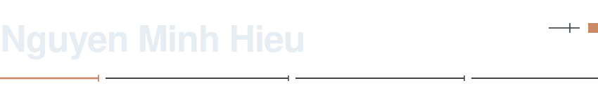

<picture>
  <source media="(prefers-color-scheme: dark)" srcset="assets/masthead-dark.svg">
  <source media="(prefers-color-scheme: light)" srcset="assets/masthead-light.svg">
  
</picture>

 

Cyber Security student at **USTH** (Hanoi, Vietnam), studying how software behaves when pushed past its assumptions. I work with quiet self-discipline — digging into binaries and stubborn edge cases on my own until the mechanics are clear.

#### Focus

- **Reverse Engineering** — Static and dynamic binary analysis (`IDA Pro`, `Ghidra`).
- **Memory & Pwn** — C memory safety, fuzzing, and x86-64 exploitation (`libFuzzer`, `GDB`).
- **Linux & Isolation** — Linux internals and process sandboxing (`Docker`, `Bubblewrap`).
- **Web Protocols & Crypto** — Protocol reverse engineering, client-side anti-bot analysis (`Burp Suite`), and cryptography.

#### Community

- **USTH Cyber Security Club (UCS)** — Head of Technical Division; challenge authoring and monthly hands-on sessions.
- **USTH_Ex0dia** — Competitive CTF team (DDC onsite finalist · SVANM · MTA CTF).

 

<picture>
  <source media="(prefers-color-scheme: dark)" srcset="assets/rule-dark.svg">
  <source media="(prefers-color-scheme: light)" srcset="assets/rule-light.svg">
  
</picture>

[ctftime.org/user/261154](https://ctftime.org/user/261154) &nbsp;·&nbsp; [absolute3k@gmail.com](mailto:absolute3k@gmail.com)
