

  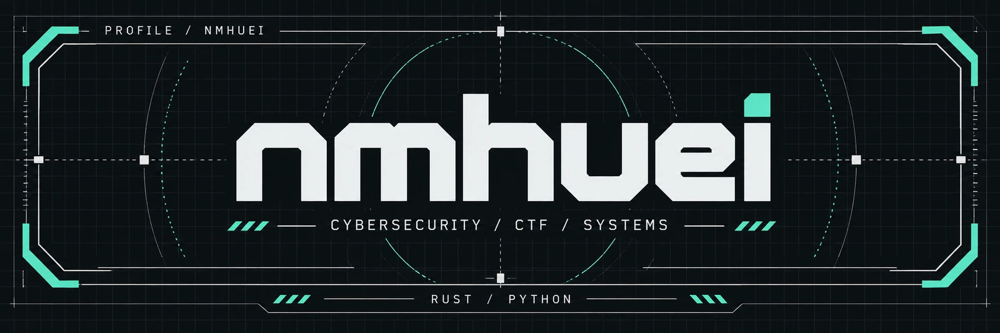

  CYBERSECURITY STUDENT · CTF PLAYER · RUST &amp; PYTHON

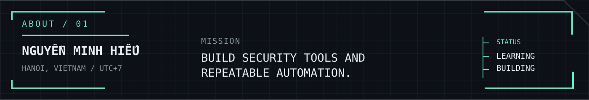

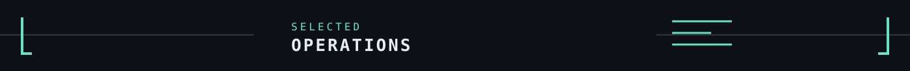

<a href="https://github.com/nmhuei/bqa-mcp">
  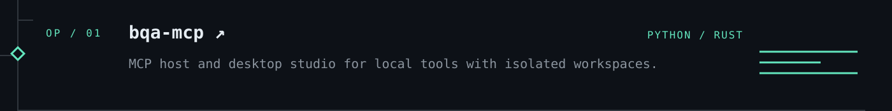
</a>

<a href="https://github.com/nmhuei/ctf-toolkit">
  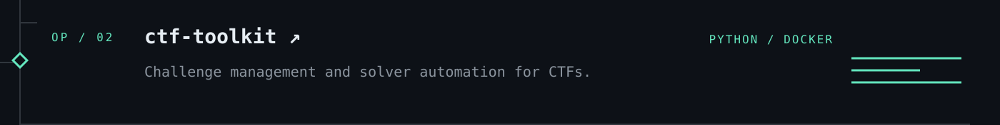
</a>

<a href="https://github.com/nmhuei/gpt_cli">
  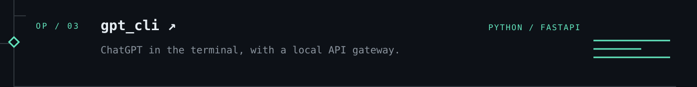
</a>

<a href="https://github.com/nmhuei/opencode2claude">
  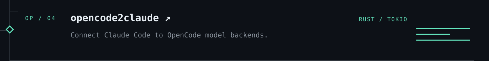
</a>

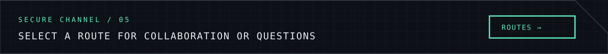

<a href="mailto:absolute3k@gmail.com">
  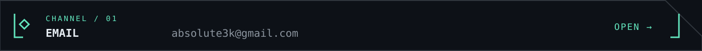
</a>

<a href="https://codeforces.com/profile/nmh_asin">
  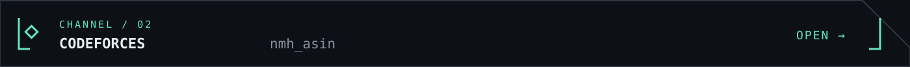
</a>

<a href="https://github.com/nmhuei">
  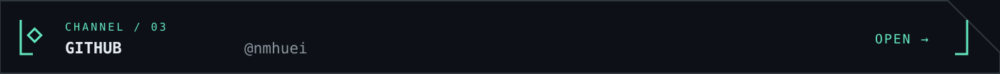
</a>
